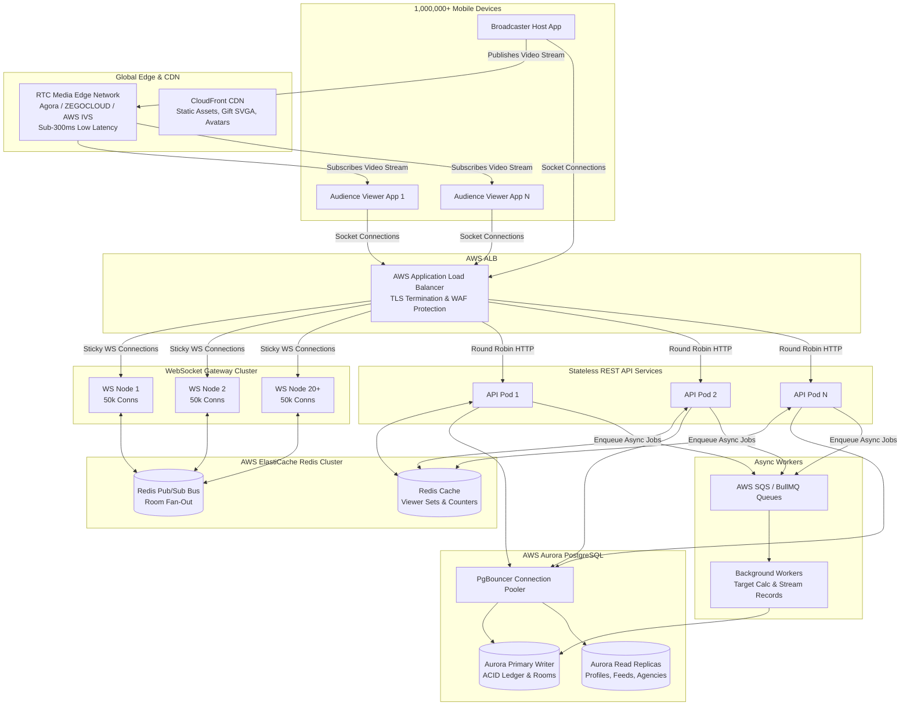

# 01 — Million Concurrent Users (1M+ CCU) Architecture

This document details the enterprise architectural design required to handle **1,000,000+ simultaneous concurrent users (CCU)** across live broadcasts, audience viewing, real-time gifting, and talent agency operations.

---

## 1. The Scaling Challenge: Math at 1M+ CCU

Handling 1,000,000 concurrent users on a live video platform is fundamentally different from standard e-commerce or social feeds:

```
┌─────────────────────────┐   1,000,000 concurrent viewers
│  1.5 Terabits / second  │   Streaming 720p/1080p video @ 1.5 Mbps
└─────────────────────────┘
┌─────────────────────────┐   1,000,000 active persistent TCP connections
│   1M WebSocket Conns    │   Receiving room events, presence, and chat
└─────────────────────────┘
┌─────────────────────────┐   Top rooms with 100k+ viewers receiving gifts
│ 250,000 msgs / second   │   Requires aggressive batching & Redis pub/sub
└─────────────────────────┘
```

> [!CRITICAL]
> **Why Origin Media Servers Fail:**
> A single enterprise cloud server (e.g., AWS c5.4xlarge with 10 Gbps network) can at most serve ~6,000 concurrent video streams before network saturation. To serve 1,000,000 concurrent video streams, you would need over **150 large dedicated media servers** if self-hosted. 
> **The Production Solution:** Offload media video distribution to a global Software-Defined Real-time Network (SD-RTN) edge (Agora / ZEGOCLOUD / AWS IVS), while our custom backend handles signaling, business logic, agency targets, and the financial ledger.

---

## 2. End-to-End System Architecture



---

## 3. High-Concurrency Scaling Strategies

### A. Real-time Signaling & Chat Fan-Out (Redis Pub/Sub)
* **WebSocket Horizontal Partitioning**: Each WebSocket container (Node.js / uWebSockets or NestJS) maintains up to 50,000 persistent TCP connections. For 1M connections, a cluster of 20 to 25 container instances runs on AWS ECS Fargate behind an Application Load Balancer.
* **Room Pub/Sub Channels**: Instead of broadcasting messages server-by-server, WebSocket nodes subscribe only to active rooms currently occupied by their local connections using Redis Pub/Sub channels (`room:{roomId}:events`).
* **Chat Throttling & Message Batching**:
  * In rooms with > 10,000 viewers, individual chat messages are buffered into 100ms micro-batches before fan-out.
  * Mobile clients use a virtualized list view with drop-frame strategies to prevent UI freezes.

### B. Live Room Viewer Presence & Leaderboards
* **Redis Sorted Sets (`ZSET`)**:
  * Room viewers are stored in a sorted set: `ZADD room:{roomId}:viewers {timestamp} {userId}`.
  * Getting live audience count is an $O(1)$ operation: `ZCARD room:{roomId}:viewers`.
  * Top gifters ranking per room is maintained in: `ZREVRANGEBYSCORE room:{roomId}:gifters +inf -inf LIMIT 0 10`.

### C. Database Concurrency & Zero-Drift Financial Ledger
In a peak room, 5,000 viewers may send gifts simultaneously. To prevent database deadlock and transaction rollbacks:
1. **Atomic In-Memory Deduct with Redis Lua Script**:
   * Verify and decrement viewer's cached coin balance atomically in Redis.
   * If balance is insufficient, reject immediately at memory speed (< 2ms) without hitting PostgreSQL.
2. **Double-Entry Asynchronous Ledger Write**:
   * Enqueue the financial transaction event into a high-throughput queue (SQS / Redis Stream).
   * Dedicated ledger workers commit transactions in atomic batches to PostgreSQL using `INSERT INTO wallet_transactions` with strict idempotency keys.

### D. Prevention of "Thundering Herd" on Stream Termination
When a mega-host with 150,000 viewers ends their live broadcast:
* **The Problem**: 150,000 clients simultaneously hit `/api/rooms/recommended` or disconnect from WebSocket, overwhelming the API gateway.
* **The Solution**:
  * **Client-side Jitter**: Clients inject random delays (between 0 and 2,500ms) before requesting the next recommended stream.
  * **CDN Edge Caching**: The discovery feed (`/api/rooms/discovery`) is cached on AWS CloudFront for 3 seconds (`s-maxage=3, stale-while-revalidate=5`), absorbing 99% of incoming read requests at the edge.

---

## 4. Hardware Sizing & AWS Topology (1M CCU Capacity)

| Component | AWS Resource Type | Quantity / Sizing | Concurrency Throughput |
| :--- | :--- | :--- | :--- |
| **Media Distribution** | Global SD-RTN Edge Network | Managed Multi-Region | 1,000,000+ simultaneous streams |
| **WebSocket Cluster** | AWS ECS Fargate (`c6g.2xlarge`) | 20–25 Tasks (Auto-scaling) | 1,250,000 persistent sockets |
| **REST API Cluster** | AWS ECS Fargate (`c6g.xlarge`) | 12–16 Tasks (Auto-scaling) | 15,000+ HTTP req/sec |
| **In-Memory Cache** | AWS ElastiCache Redis Cluster | 3 Shards (6 nodes Multi-AZ) | 250,000+ ops/sec with sub-millisecond latency |
| **Primary Database** | AWS Aurora PostgreSQL (`db.r6g.4xlarge`) | 1 Primary + 3 Read Replicas | 40,000 IOPS, connection pooling via PgBouncer |
| **Async Queues** | AWS SQS (FIFO for Wallets) | Serverless | Unlimited auto-scaled throughput |

---

## 5. Security, DDoS & Rate Limiting
* **AWS WAF**: Integrated at the ALB layer to filter automated bot attacks, SQL injections, and Layer 7 HTTP floods.
* **Token Bucket Rate Limiting**: Enforced per IP and per authenticated user (`10 req/sec` for standard APIs, `2 req/sec` for gift/wallet actions).
* **JWT Access & Refresh Tokens**: Lightweight stateless JWT verification on API containers without requiring database round-trips for each authenticated request.
